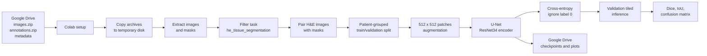

# IGNITE H&E Tissue Segmentation


This repository contains Google Colab notebooks for supervised and semi-supervised **U-Net
segmentation** of IGNITE v2 H&E tissue compartments. The baseline prepares the dataset,
creates a patient-aware validation split, trains a U-Net with an ImageNet-pretrained ResNet34
encoder, evaluates class-wise Dice/IoU, and saves checkpoints and plots to Google Drive.

> This is a practical baseline for experimentation. It is not an exact reproduction of the official pathology-adapted nnU-Net training or inference pipeline.

## Contents

- [Pipeline at a glance](#pipeline-at-a-glance)
- [Repository structure](#repository-structure)
- [Dataset](#dataset)
- [Model and training](#model-and-training)
- [Mean Teacher semi-supervised training](#mean-teacher-semi-supervised-training)
- [Quick start](#quick-start)
- [Outputs](#outputs)
- [Important evaluation notes](#important-evaluation-notes)
- [Next experiments](#next-experiments)
- [References and citation](#references-and-citation)

## Pipeline at a glance



### What the notebook does

1. Mounts Google Drive and checks the four required input files.
2. Copies compressed data to Colab temporary storage for faster I/O.
3. Extracts images and annotations and reads `data_overview.csv`.
4. Keeps only rows where `task == "he_tissue_segmentation"`.
5. Pairs image/mask files and verifies dimensions and label values.
6. Creates a patient-grouped holdout by default, preventing patient leakage.
7. Samples 512 x 512 patches for training.
8. Trains U-Net + ResNet34 with mixed precision when CUDA is available.
9. Evaluates full validation ROIs using tiled inference.
10. Saves the best model, last checkpoint, history, metrics, and visualizations.

## Repository structure

```text
.
├── IGNITE_H_and_E_Segmentation_Colab.ipynb  # End-to-end Colab notebook
├── IGNITE_H_and_E_Mean_Teacher_Colab.ipynb  # Earlier Mean Teacher experiment
├── IGNITE_H_and_E_Mean_Teacher_Colab_final.ipynb
│                                             # Finalized semi-supervised notebook
├── data_overview.csv                        # Image, task, patient, and split metadata
├── he_label_map.json                        # H&E class ID to class-name mapping
├── annotations.zip                          # Compressed annotation masks
├── images.zip.parts.txt                     # Windows command to rebuild split image archive
└── README.md                                # Project documentation
```

The extracted archives are intentionally not committed as directories. The notebook expects them to be staged in Google Drive before execution.

## Dataset

The included metadata contains 887 records across multiple IGNITE tasks. The notebook selects the H&E segmentation subset:

| Property | Value |
|---|---:|
| Total metadata records | 887 |
| H&E segmentation records | 408 |
| Unique patients in metadata | 155 |
| H&E stain | H&E |
| Segmentation classes | 17 IDs (`0`-`16`) |
| Default patch size | 512 x 512 |
| Default validation fraction | 20% of training patients |

The H&E records include images from sources such as RUMC, SCDC, and TCGA and contain patient, ROI, organ, specimen, scanner, shape, area, and split information.

### Label map

Label `0` is **Unannotated** and is ignored by the training loss. It must not be confused with background.

| ID | Tissue class | ID | Tissue class |
|---:|---|---:|---|
| 0 | Unannotated | 9 | Erythrocytes |
| 1 | Background | 10 | Bronchial epithelium |
| 2 | Tumor epithelium | 11 | Mucus/Plasma/Fluids |
| 3 | Reactive epithelium | 12 | Cartilage/Bone |
| 4 | Stroma | 13 | Macrophages |
| 5 | Inflammation | 14 | Muscle |
| 6 | Alveolar tissue | 15 | Liver |
| 7 | Fatty tissue | 16 | Keratinization |
| 8 | Necrotic tissue | | |

The complete mapping is available in [`he_label_map.json`](./he_label_map.json).

## Model and training

| Component | Configuration |
|---|---|
| Architecture | U-Net |
| Encoder | ResNet34, ImageNet-pretrained |
| Number of classes | 17 |
| Loss | Cross-entropy with `ignore_index=0` |
| Optimizer | AdamW |
| Learning rate | `1e-4` |
| Weight decay | `1e-4` |
| Default batch size | 4 |
| Default epochs | 10 |
| Metrics | Class-wise Dice and IoU |
| Validation | Tiled full-ROI inference |

The notebook uses `segmentation-models-pytorch`, PyTorch, NumPy, pandas, Pillow, scikit-learn, matplotlib, and tqdm. It installs or upgrades `segmentation-models-pytorch` inside Colab.

## Mean Teacher semi-supervised training

[`IGNITE_H_and_E_Mean_Teacher_Colab_final.ipynb`](./IGNITE_H_and_E_Mean_Teacher_Colab_final.ipynb)
extends the baseline for experiments with limited annotations:

- Reuses the patient-grouped 20% validation split from the supervised workflow.
- Uses a reproducible 20% labelled / 80% unlabelled split of training patients.
- Trains a student U-Net and an exponential-moving-average (EMA) teacher U-Net.
- Applies supervised cross-entropy to labelled masks and confidence-filtered consistency loss
  to unlabelled images.
- Evaluates and saves the teacher model; validation masks and the official test split remain
  isolated from training.

The default Mean Teacher configuration uses `PATCH_SIZE = 512`, `BATCH_SIZE = 2`,
`EMA_DECAY = 0.99`, `CONFIDENCE_THRESHOLD = 0.70`, and a five-epoch consistency-loss
ramp-up. Its outputs are stored in:

```text
MyDrive/IGNITE/training_outputs/ignite_he_mean_teacher_20pct/
```

For a fair comparison, train a supervised control with the same labelled patient IDs,
validation split, crop settings, and random seeds. Do not compare the Mean Teacher result
only with the full-supervision baseline, because that baseline uses more labelled data.

## Quick start

### 1. Prepare the data

Create a folder named `IGNITE` in Google Drive and upload:

```text
images.zip
annotations.zip
data_overview.csv
he_label_map.json
```

The repository includes `annotations.zip`. The image archive is distributed as split parts because of file-size limits. On Windows, rebuild it with the command documented in [`images.zip.parts.txt`](./images.zip.parts.txt):

```powershell
copy /b images.zip.part01+images.zip.part02+images.zip.part03+images.zip.part04+images.zip.part05+images.zip.part06 images.zip
```

### 2. Open the notebook

Open [`IGNITE_H_and_E_Segmentation_Colab.ipynb`](./IGNITE_H_and_E_Segmentation_Colab.ipynb) in Google Colab and select:

**Runtime -> Change runtime type -> T4 GPU** (or another available CUDA GPU).

### 3. Check configuration

The main configuration cell uses:

```python
DRIVE_DATA_DIR = Path("/content/drive/MyDrive/IGNITE")
PATCH_SIZE = 512
BATCH_SIZE = 4
EPOCHS = 10
SPLIT_MODE = "patient_grouped"
VAL_FRACTION = 0.20
RESUME_TRAINING = False
```

Reduce `BATCH_SIZE` if the GPU runs out of memory. For a longer experiment, increase `EPOCHS` after confirming that the first run completes.

### 4. Run the notebook in order

Run the cells from top to bottom. The notebook checks required files and free disk space before extraction, reports the selected records and split overlap, previews image/mask pairs, trains the model, and displays validation predictions.

To resume after a Colab disconnect:

1. Reconnect Google Drive.
2. Set `EPOCHS` to a value greater than the saved epoch.
3. Set `RESUME_TRAINING = True`.
4. Rerun the setup and training cells.

### 5. Run the Mean Teacher experiment (optional)

Open [`IGNITE_H_and_E_Mean_Teacher_Colab_final.ipynb`](./IGNITE_H_and_E_Mean_Teacher_Colab_final.ipynb)
in Google Colab after extracting the H&E folders in Google Drive:

```text
MyDrive/IGNITE/
├── images/he/
├── annotations/he/
├── data_overview.csv
└── he_label_map.json
```

The Mean Teacher notebook reads the extracted folders directly rather than ZIP archives.
Run its cells from top to bottom, keep `RESUME_TRAINING = False` for a new experiment, and
set it to `True` after a disconnect when resuming from `last_checkpoint.pth`. Change
`LABELED_FRACTION` only when defining a new label-budget experiment.

## Outputs

By default, outputs are stored in:

```text
MyDrive/IGNITE/training_outputs/ignite_he_unet_resnet34/
```

Typical outputs include:

```text
best_model.pth                 # Checkpoint with the best foreground validation Dice
last_checkpoint.pth            # Most recent resumable checkpoint
training_history.csv           # Epoch-level loss and validation metrics
validation_class_metrics.csv   # Class-wise Dice, IoU, and pixel support
validation_confusion_matrix.npy
validation_prediction.png       # H&E image, ground truth, prediction, and overlay
```

The exact set of files is printed by the final notebook cell.

## Important evaluation notes

- The default split is **patient-grouped** to reduce leakage between training and validation.
- `SPLIT_MODE = "official_fold"` is available when you need to evaluate one of the supplied `fold0`-`fold4` assignments.
- The supplied fold assignment can be ROI-based, so inspect and report patient overlap when using it.
- Keep records with `split == "test"` untouched until model selection and development are complete.
- Report class-wise Dice/IoU in addition to aggregate scores because rare tissue classes can be hidden by a single accuracy value.
- Do not describe validation scores as test scores.
- The notebook's supervised baseline uses labelled images only; it does not yet implement semi-supervised learning.

## Next experiments

Suggested extensions after reproducing the baseline:

1. Compare 10%, 25%, 50%, and 100% labelled-patient training sets.
2. Keep the validation patients and metrics fixed across experiments.
3. Repeat Mean Teacher experiments with 10%, 25%, and 50% labelled patients.
4. Add a FixMatch-style semi-supervised objective.
5. Compare against the official nnU-Net inference and evaluation workflow.
6. Report per-class performance, patient overlap, and the exact split configuration.

## References and citation

- [IGNITE v2 dataset on Zenodo](https://zenodo.org/records/17735903)
- [Official IGNITE data toolkit](https://github.com/DIAGNijmegen/ignite-data-toolkit)
- [Official H&E inference script](https://github.com/DIAGNijmegen/ignite-data-toolkit/blob/main/code/he_segmentation/inference.py)
- [Official H&E evaluation script](https://github.com/DIAGNijmegen/ignite-data-toolkit/blob/main/code/he_segmentation/evaluation.py)
- [Dataset paper preprint](https://arxiv.org/abs/2507.16855)

Dataset citation:

> Spronck et al. (2025). *A tissue and cell-level annotated H&E and PD-L1 histopathology image dataset in non-small cell lung cancer*. arXiv:2507.16855.

The dataset is licensed **CC BY-NC-SA 4.0**. Review the dataset terms before publishing or redistributing derived work.
